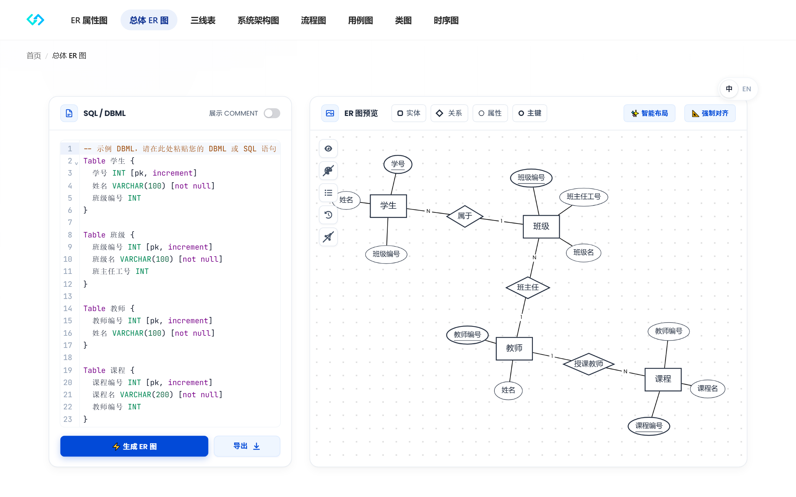
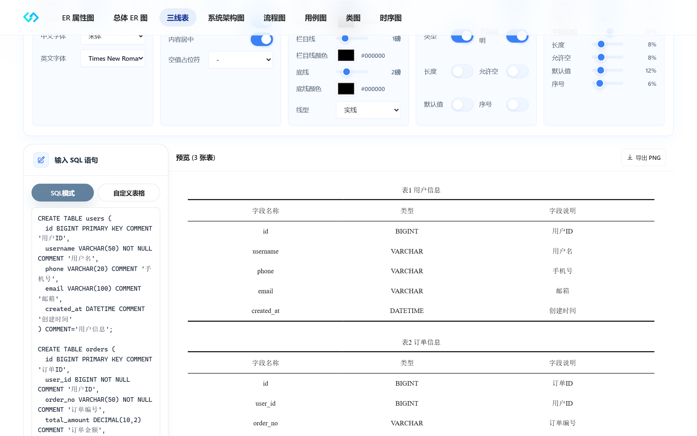
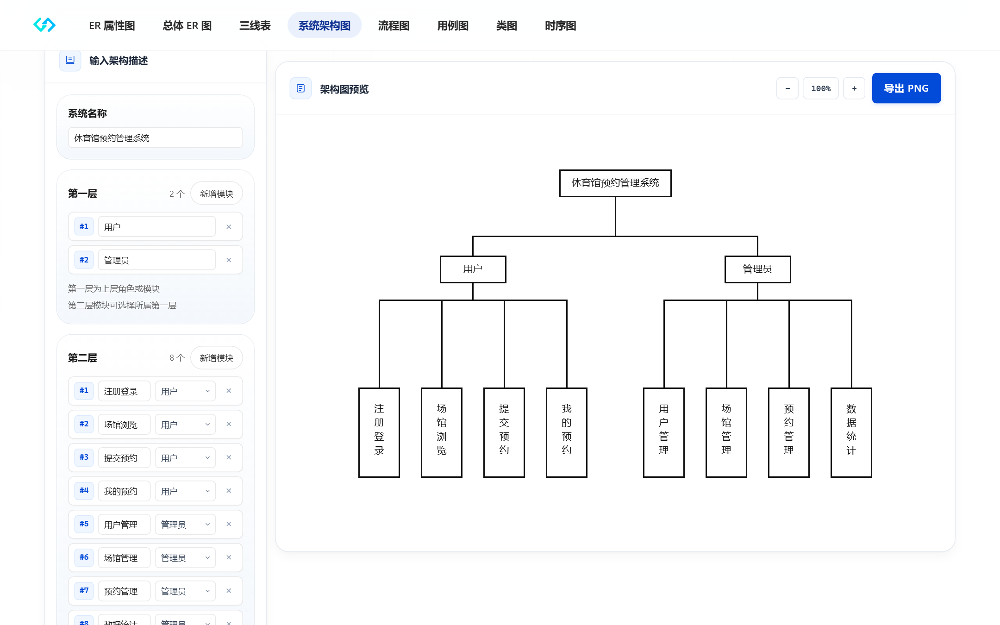

<div align="center">

# 📊 sql2diagram

**专为毕业设计与学术论文打造的在线规范绘图工具箱**

<p>
  <b>免安装 · 100% 纯前端离线计算 · 论文标准图表一键生成 · 300DPI 矢量导出</b>
</p>

[](https://github.com/Anlon-27/sql2diagram/stargazers)
[](LICENSE)
[](https://vuejs.org/)
[](https://vitejs.dev/)
[](https://g6.antv.vision/)

<br />


</div>

> **学术级 SQL 转 ER 图与毕设论文规范绘图工具箱** | *The All-in-One Academic Diagram Toolkit & SQL-to-Diagram Generator for Research and Thesis.*  
> 专为计算机与软件工程高校学生、科研学者及毕业答辩打造，涵盖 SQL 一键转陈氏 ER 属性图、AntV G6 多表全局实体关联、国标学术三线表(GB/T)、系统分层架构拓扑、业务流程图、UML 类图/时序图/用例图、纯前端本地离线语法解析及 300DPI 论文级超清矢量导出等全套学术制图规范。

---

## 🌟 为什么选择 sql2diagram？（痛点与工具对比）

每年高校计算机、软件工程相关专业的同学在撰写毕业论文或课程设计时，常在绘图排版环节遭遇大量阻碍：

| 评价维度 | 传统通用绘图软件 (Visio / ProcessOn) | 数据库管理客户端 (Navicat / DBeaver) | **sql2diagram (本项目)** |
| :--- | :--- | :--- | :--- |
| **排版效率** | 手动拖拉椭圆、矩形与连接线，耗时数小时 | 一键导出，但仅支持物理网格表 | **直接粘贴建表 SQL，毫秒级自动排版就绪** |
| **学术规范** | 极易出现图形混淆、主键漏标下划线 | ❌ **导师常直接驳回**（严禁将物理模型图直接当概念ER图） | **严格遵循陈氏概念 ER 模型规范与国标 GB/T** |
| **三线表支持** | 需在 Word 中繁琐设置边框线磅数与内外线 | 完全不支持导出学术论文表格格式 | **一键生成符合规范的标准三线表（顶底粗、栏目细）** |
| **隐私安全** | 依赖云端服务器，数据库语句存在上传泄露风险 | 本地运行，但缺少论文格式化支持 | **100% 纯前端浏览器沙箱解析，零网络数据外发** |
| **导出清晰度** | 免费导出受限，常常模糊或带有水印 | 截图插入 Word 打印有明显锯齿噪点 | **支持 300DPI 论文级超清 PNG 与 SVG 矢量导出** |

---

## 📸 核心工作区与学术规范支持

<table border="0">
  <tr>
    <td width="50%">
      <br/>
      <b>📌 1. 学术标准陈氏 ER 属性图</b><br/>
      <sub>实体矩形、属性椭圆、主键自动加粗下划线标注，符合学术评审标准。</sub>
    </td>
    <td width="50%">
      <br/>
      <b>📌 2. AntV G6 全局实体关联图</b><br/>
      <sub>支持多张建表 SQL 批量导入，力导向算法自动计算多表主外键关联拓扑。</sub>
    </td>
  </tr>
  <tr>
    <td width="50%">
      <br/>
      <b>📌 3. 国家标准学术三线表 (GB/T)</b><br/>
      <sub>自动提取字段、类型、中文注释与主键，顶底粗线(1.5pt)、栏目细线(0.75pt)。</sub>
    </td>
    <td width="50%">
      <br/>
      <b>📌 4. 软件工程系统分层架构图</b><br/>
      <sub>表现层、业务逻辑层、数据持久层清晰分层卡片排版，论文答辩展示力强。</sub>
    </td>
  </tr>
</table>

### 齐全的毕设全套软工图种覆盖（共 8 大统一工作区）：
1. **ER 属性图**：粘贴建表 SQL，一键提取实体与属性椭圆，主键标注下划线，连线自动防遮挡。
2. **总体 ER 图**：嵌入基于 AntV G6 的多表关联关系图，画布透明磨砂质感，支持高缩放比拖拽。
3. **学术三线表**：国标三线表格式，消除多余纵线，支持字段注释智能解析，一键复制与导出。
4. **系统架构图**：分层定义模块及连接拓扑，内置微服务、MVC、三层架构等常用学术模板。
5. **业务流程图**：标准流程图图元规范（起止框、判定框、输入输出框），支持分支与回路。
6. **UML 用例图**：系统边界、参与者（Actor）、用例气泡及 `<<include>>` 关联清晰表达。
7. **UML 类图**：标准三格类图（类名、属性域、方法域），支持继承、实现、聚合等多种连线。
8. **UML 时序图**：轻量级时序语法驱动，支持对象生命线、同步/异步消息流及 alt/opt/loop 片段。

---

## ⚡ 30 秒快速体验（代码示例）

无需任何前期准备，在 **ER 属性图** 或 **学术三线表** 中粘贴如下建表 SQL，即可即时体验：

```sql
CREATE TABLE `student` (
  `id` bigint NOT NULL AUTO_INCREMENT COMMENT '学号主键',
  `student_no` varchar(32) NOT NULL COMMENT '学号',
  `name` varchar(50) NOT NULL COMMENT '学生姓名',
  `gender` varchar(8) DEFAULT '未知' COMMENT '性别',
  `major` varchar(100) DEFAULT NULL COMMENT '所学专业',
  `gpa` decimal(3,2) DEFAULT '0.00' COMMENT '平均绩点',
  `enrollment_date` date DEFAULT NULL COMMENT '入学日期',
  PRIMARY KEY (`id`),
  UNIQUE KEY `uk_student_no` (`student_no`)
) ENGINE=InnoDB DEFAULT CHARSET=utf8mb4 COMMENT='学生基本信息表';
```

👉 **解析结果**：
- 自动识别实体为 **学生**；
- 属性节点自动提取字段名与中文释义；
- 主键 `id` 自动渲染学术下划线；
- 三线表自动排版为标准的四列/五列国标表格格式。

---

## 🔒 隐私与安全性设计

* **100% Client-side 运算**：所有的 SQL AST 语法树解析、图形布局算法与三线表格式化均在**用户本地浏览器沙箱**中运行。
* **零敏感数据上报**：工具不会向任何后端服务器上传您的 SQL 语句或业务结构，即使在离线局域网或内网环境下也能无损运行。
* **高精度绘图引擎**：基于 DOM/SVG 矢量计算与 Canvas 动态栅格化，导出 300DPI PNG 打印级图片或无损 SVG，杜绝缩放模糊。

---

## 🛠️ 本地开发与构建部署

### 环境要求
- Node.js `>= 18.0.0`
- npm `>= 9.0.0`

### 1. 本地启动开发
```bash
# 克隆仓库
git clone https://github.com/Anlon-27/sql2diagram.git
cd sql2diagram

# 安装依赖
npm install

# 启动本地开发服务 (基于 Vite)
npm run dev
```
启动后在浏览器打开控制台输出的本地地址（默认 `http://localhost:5173`）即可使用。

### 2. 生产环境打包
```bash
npm run build
```
执行完毕后，生成的全部静态产物位于 `dist/` 目录中。

### 3. 一键免费托管（推荐）
由于本项目是 100% 纯前端静态架构，你可以直接将其零成本部署至各大主流平台：

* **Vercel**：在 Vercel 中导入本仓库，构建预设选择 `Vite`，输出目录填写 `dist`，点击 **Deploy** 即可。
* **Cloudflare Pages**：连接 GitHub 仓库，构建命令填写 `npm run build`，输出目录填写 `dist`。
* **GitHub Pages**：在仓库 Settings -> Pages 中开启服务，选择从 Actions 或静态构建分支发布。
* **Nginx 私有化自建**：直接将 `dist/` 静态文件夹放置于服务器，配置静态目录并开启 `try_files $uri $uri/ /index.html;`。

---

## 🎓 论文排版学术规范常见问答 (FAQ)

<details>
<summary><b>Q1: 为什么导师常常驳回 Navicat / PowerDesigner 导出的物理数据模型图？</b></summary>
答：在高校计算机与软工毕业设计评审中，概念模型设计（Conceptual Data Model）与物理数据库实现有着严格的学术区分。数据库软件导出的往往是包含外键约束、字段类型和索引详情的“物理表关系图”，而学术论文正文中必须呈现的是经典的<b>陈氏 ER 模型（Chen's ER Model）</b>，即矩形代表实体、椭圆代表属性、菱形代表关系。使用物理网格图代替 ER 图是毕设答辩常见的扣分点。
</details>

<details>
<summary><b>Q2: 学术论文中的“标准三线表”有什么格式硬性要求？</b></summary>
答：根据国家标准（GB/T）科技论文编写规范，标准三线表由<b>顶线、底线和栏目线</b>三条水平主线组成，严禁出现竖向分割线和单元格网格线。通常顶线与底线线宽设定为 1.5 磅（粗线），栏目线设定为 0.75 磅（细线）。本项目生成的三线表严格遵守此比例规范。
</details>

<details>
<summary><b>Q3: 为什么导出的图片插入 Word 打印或转 PDF 会变模糊？</b></summary>
答：屏幕显示通常基于 72 或 96 DPI，若直接截屏插入 Word，论文打印时会出现明显的锯齿和毛边。sql2diagram 在导出时自动通过高倍 Canvas 进行超采样，输出标准的 <b>300 DPI 超高清图像</b>，并同时支持 <b>SVG 矢量格式</b>，插入 Word 后任意放大缩放均可保持绝对锐利。
</details>

---

## 🤝 参与贡献与致谢

欢迎提交 Issue 或 Pull Request 共同完善 sql2diagram！
* 如果这个项目在你的毕业论文写作、答辩出图或日常开发中帮到了你，请给项目点一个 **⭐️ Star**，让更多被画图困扰的同学受益！
* 核心底层图形库感谢 [Vue 3](https://github.com/vuejs/core)、[AntV G6](https://github.com/antvis/G6) 及 [CodeMirror](https://github.com/codemirror/dev)。

---

## 📄 开源许可证

本项目基于 [MIT License](LICENSE) 协议开源。
